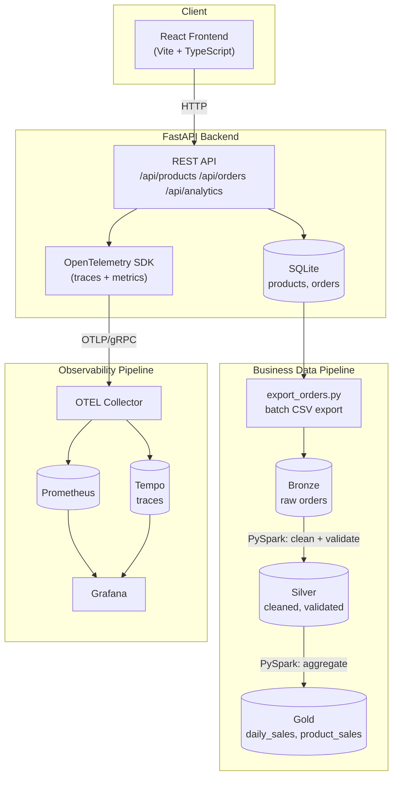
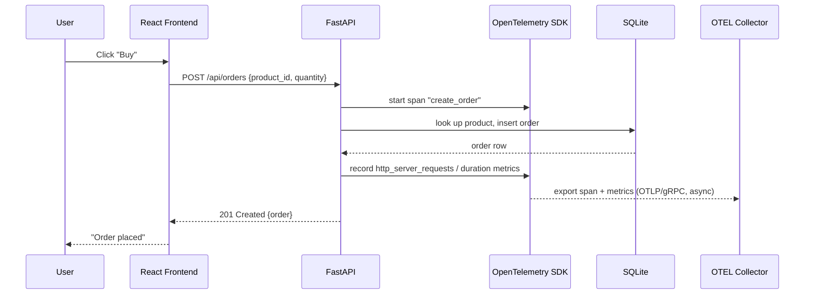
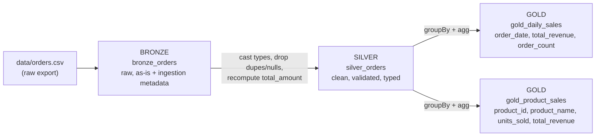
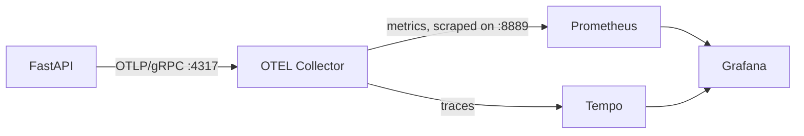

# E-Commerce Data & Observability Platform

A small, end-to-end demo of a modern data + observability stack built around
a toy e-commerce app: **React** frontend, **FastAPI** backend, a
**PySpark / Databricks / Delta Lake** batch analytics pipeline, and an
**OpenTelemetry → Prometheus/Grafana/Tempo** observability stack, all wired
together with **Docker Compose**.

It's intentionally small (a 1–2 day build), not a production system: no
auth, no payments, no Kubernetes, no Kafka. The goal is to demonstrate how
these pieces actually fit together, not to build the biggest possible
project.

---


## 1. Architecture

System has **two deliberately separate pipelines** that both start at
FastAPI and never cross:

- a **business data pipeline** (order data → PySpark → Delta Lake), and
- an **application observability pipeline** (request telemetry → OpenTelemetry → Prometheus/Grafana).



`data_pipeline/` runs the exact same Bronze → Silver → Gold logic either
**locally** (open-source `delta-spark`, no cluster needed) or on
**Databricks** (`databricks/`, Unity Catalog managed Delta tables) — see
[§10](#10-running-the-data-pipeline) and [§11](#11-running-it-in-databricks).

---

## 2. Technology stack

| Layer | Technology | Why |
|---|---|---|
| Frontend | React + TypeScript + Vite | Fast dev loop, typed UI code, minimal build config |
| Backend | FastAPI + Pydantic + SQLAlchemy | Async-capable, typed request/response models, automatic OpenAPI docs |
| Operational DB | SQLite | Zero setup for a demo; swappable for Postgres in a real deployment |
| Data processing | PySpark | See [§13](#13-why-each-technology-exists) |
| Data platform | Databricks | See [§13](#13-why-each-technology-exists) |
| Table format | Delta Lake | See [§13](#13-why-each-technology-exists) |
| Instrumentation | OpenTelemetry | See [§13](#13-why-each-technology-exists) |
| Metrics | Prometheus | See [§13](#13-why-each-technology-exists) |
| Traces | Grafana Tempo | Lightweight, Grafana-native trace backend, no separate query UI needed |
| Dashboards | Grafana | See [§13](#13-why-each-technology-exists) |
| Containers | Docker / Docker Compose | One-command local environment for app + observability stack |

---

## 3. Request flow: placing an order



The telemetry export to the Collector is asynchronous and non-blocking —
if the Collector isn't running, order creation still works exactly the
same; you just won't see it in Grafana.

---

## 4. Data pipeline: Bronze → Silver → Gold (Medallion architecture)



| Layer | Table(s) | What happens |
|---|---|---|
| **Bronze** | `bronze_orders` | Raw CSV read as strings, tagged with `_ingested_at` / `_source_file`. No cleaning — a faithful copy of what arrived. |
| **Silver** | `silver_orders` | Casts every column to its real type, drops duplicate order ids (`dropDuplicates`), drops rows with null/blank product name, null or non-positive quantity/price, or an unparsable timestamp, and **recomputes `total_amount`** from `quantity * unit_price` rather than trusting the raw value. |
| **Gold** | `gold_daily_sales`, `gold_product_sales` | Business-ready aggregates: revenue/order count per day, and units sold/revenue per product. |

The sample dataset (`data/orders.csv`, generated by
`data_pipeline/generate_sample_orders.py`) deliberately includes a
duplicate row, a null quantity, a negative quantity, a blank product name,
and a row whose `total_amount` doesn't match `quantity * unit_price` — so
the Silver layer's cleaning rules have real, visible work to do.

Same transformation code, two run modes:

- **Local**: `data_pipeline/jobs/*.py` + `run_local_pipeline.py`, using
  open-source `delta-spark`, writing Delta tables to `data/delta/`.
- **Databricks**: `databricks/01_bronze_ingestion.py`,
  `02_silver_transformation.py`, `03_gold_aggregation.py`, writing managed
  Unity Catalog tables `ecommerce.bronze_orders`, `ecommerce.silver_orders`,
  `ecommerce.gold_daily_sales`, `ecommerce.gold_product_sales`.

**Note on the live Analytics page:** `GET /api/analytics` computes its
numbers directly from the operational SQLite `orders` table, *not* from the
Gold Delta tables — see [§14](#14-design-decisions--tradeoffs) for why.

---

## 5. Observability architecture



FastAPI is instrumented with:
- **Automatic** HTTP spans (method, route, status code, exceptions) via
  `opentelemetry-instrumentation-fastapi`.
- **Custom spans** for the operations that actually matter: `create_order`,
  `get_products`, `get_orders`, `get_analytics` (not every function — see
  `backend/app/api/*.py`).
- **Explicit metrics** (`http_server_requests`, `http_server_duration`,
  `http_server_errors`) recorded in a small middleware
  (`backend/app/telemetry/otel.py`), so the Grafana dashboard queries
  against predictable, hand-chosen names instead of a library version's
  semantic-convention naming.

The provisioned Grafana dashboard ("Ecommerce API - Observability") has 4
panels: **Request Rate**, **API Latency (p95)**, **Error Rate**, and
**Requests by Endpoint**.

---

## 6. Project structure

```
ecommerce-data-platform/
├── frontend/            React + TypeScript + Vite UI
├── backend/              FastAPI + SQLite + OpenTelemetry
│   ├── app/
│   │   ├── api/          route handlers
│   │   ├── models/        SQLAlchemy ORM models
│   │   ├── schemas/       Pydantic request/response models
│   │   ├── services/      business logic
│   │   ├── database/      engine/session/seed data
│   │   └── telemetry/     OpenTelemetry setup
│   ├── scripts/           export_orders.py, generate_traffic.py
│   └── tests/             pytest suite
├── data_pipeline/        PySpark jobs (local, delta-spark)
│   ├── jobs/              bronze_ingestion / silver_transformation / gold_aggregation
│   ├── run_local_pipeline.py
│   ├── generate_sample_orders.py
│   └── tests/              pytest suite
├── databricks/            Databricks-native notebook equivalents
├── data/                  orders.csv + local Delta table output
├── observability/
│   ├── otel-collector-config.yaml
│   ├── prometheus.yml
│   ├── tempo.yaml
│   └── grafana/            provisioning + dashboard JSON
├── docker-compose.yml
├── Makefile
├── .env.example
└── README.md
```

---

## 7. Local setup (without Docker)

Requires Python 3.12+, Node 20+, and Java 17+ (for PySpark) on your machine.

```bash
# 1. Backend
cd backend
pip install -r requirements.txt
cp .env.example .env          # defaults are fine for local dev
uvicorn app.main:app --reload --port 8000
# -> http://localhost:8000/docs

# 2. Frontend (in a second terminal)
cd frontend
npm install
cp .env.example .env          # defaults are fine
npm run dev
# -> http://localhost:5173
```

The SQLite database is created and seeded with 6 products automatically on
first startup (`backend/app/database/seed.py`).

Everything above also works via `make backend-install`, `make backend-dev`,
`make frontend-install`, `make frontend-dev`.

---

## 8. Docker setup (app + full observability stack)

```bash
docker compose up --build
```

| Service | URL |
|---|---|
| React frontend | http://localhost:5173 |
| FastAPI | http://localhost:8000 |
| Swagger / OpenAPI docs | http://localhost:8000/docs |
| Grafana | http://localhost:3000 (login: `admin` / `admin`, or anonymous viewer access is enabled) |
| Prometheus | http://localhost:9090 |
| OTEL Collector (OTLP) | localhost:4317 (gRPC), localhost:4318 (HTTP) |
| Tempo | http://localhost:3200 |

`docker compose down -v` also removes the named volumes (SQLite data,
Prometheus/Grafana/Tempo storage) for a clean slate.

---

## 9. API endpoints

| Method | Path | Description |
|---|---|---|
| GET | `/health` | Liveness check |
| GET | `/api/products` | List the seeded product catalog |
| GET | `/api/orders` | List all orders, most recent first |
| POST | `/api/orders` | Create an order: `{"product_id": 1, "quantity": 2}` |
| GET | `/api/analytics` | Total revenue, total orders, revenue by day, top products |

Example:

```bash
curl -X POST http://localhost:8000/api/orders \
  -H "Content-Type: application/json" \
  -d '{"product_id": 1, "quantity": 2}'
```

Full interactive docs at `http://localhost:8000/docs` once the backend is
running.

---

## 10. Running the data pipeline

**Local (no Databricks needed):**

```bash
pip install -r data_pipeline/requirements.txt   # pyspark + delta-spark
python data_pipeline/generate_sample_orders.py  # (already run once; re-run to regenerate)
python data_pipeline/run_local_pipeline.py
```

This runs Bronze → Silver → Gold against `data/orders.csv` and writes
Delta tables to `data/delta/{bronze,silver,gold}/`, printing row counts and
a preview of both Gold tables.

Or, against a real backend's SQLite data instead of the bundled sample:

```bash
cd backend && python scripts/export_orders.py   # SQLite -> data/orders.csv
cd .. && python data_pipeline/run_local_pipeline.py
```

Each job can also be run standalone for finer control, e.g.:

```bash
python -m data_pipeline.jobs.bronze_ingestion --source data/orders.csv --bronze-path data/delta/bronze/orders
python -m data_pipeline.jobs.silver_transformation
python -m data_pipeline.jobs.gold_aggregation
```

---

## 11. Running it in Databricks

1. **Create a workspace.** Databricks offers a free
   [Community Edition](https://community.cloud.databricks.com/) (single-node
   clusters, no credit card) — sufficient for this demo. A full trial
   workspace on AWS/Azure/GCP also works and additionally supports Unity
   Catalog Volumes.

2. **Import the notebooks.** In the workspace UI: *Workspace → Import*,
   and upload `databricks/01_bronze_ingestion.py`,
   `02_silver_transformation.py`, `03_gold_aggregation.py`. Databricks
   recognizes the `# Databricks notebook source` header and imports each
   file as a proper notebook (with the `# COMMAND ----------` markers
   becoming cells).

3. **Load the sample data.** Upload `data/orders.csv` to a Unity Catalog
   Volume (*Catalog → create/select a Volume → Upload*), e.g.
   `/Volumes/ecommerce/default/landing/orders.csv`. If your workspace
   doesn't have Unity Catalog enabled, upload to DBFS instead (*Data →
   Add data → Upload file to DBFS*, e.g. `dbfs:/FileStore/ecommerce/orders.csv`)
   and pass that path to the `source_path` widget in step 4.

4. **Run Bronze → Silver → Gold, in order.** Attach each notebook to a
   cluster and run all cells. Each notebook exposes its paths as widgets
   (`source_path`, `catalog_schema`) at the top if you need to override
   the defaults.

5. **Inspect the resulting Delta tables**, either with `%sql` cells:
   ```sql
   SELECT * FROM ecommerce.gold_daily_sales ORDER BY order_date;
   SELECT * FROM ecommerce.gold_product_sales ORDER BY total_revenue DESC;
   ```
   or via *Catalog Explorer* in the workspace sidebar.

**This was not run against a live Databricks workspace as part of building
this project** (no network access in the build environment) — the
notebooks are valid, Databricks-compatible PySpark using standard
`spark`/`dbutils` globals and `saveAsTable`, and mirror the
already-testable local pipeline logic exactly, but you should do a first
run yourself to confirm cluster/runtime specifics in your workspace.

---

## 12. Generating sample traffic (for the Grafana dashboards)

With the stack running (Docker or local):

```bash
cd backend
python scripts/generate_traffic.py --requests 300 --error-rate 0.08
```

This sends a realistic mix of product browsing, order creation, and a
deliberate share of failed orders (unknown product id → 404), so the
Request Rate, Latency, Error Rate, and Requests by Endpoint panels in
Grafana all have real data to show within a few seconds.

---

## 13. Why each technology exists

- **PySpark** — large-scale data transformation. It's the same DataFrame
  API whether you're processing a thousand rows locally or a trillion on a
  cluster, which is exactly why the code in `data_pipeline/jobs/` runs
  unmodified both on a laptop and (in adapted form) on Databricks.
- **Databricks** — a managed Spark / data engineering environment: cluster
  management, notebooks, job scheduling, and a Unity Catalog for governed,
  discoverable tables, without having to operate Spark infrastructure
  yourself.
- **Delta Lake** — reliable analytical tables on top of plain files: ACID
  transactions, schema enforcement, and time travel, so `mode("overwrite")`
  reruns are safe and Bronze/Silver/Gold stay consistent even if a job
  fails partway through.
- **OpenTelemetry** — vendor-neutral instrumentation. The same SDK produces
  traces and metrics that can be exported to Prometheus/Grafana/Tempo today
  and to a different backend later, without re-instrumenting the app.
- **Prometheus** — a time-series store built around pull-based scraping and
  PromQL, the de facto standard for metrics storage and querying in
  cloud-native systems.
- **Grafana** — a single pane of glass for both metrics (Prometheus) and
  traces (Tempo), with dashboards defined as code and provisioned
  automatically on startup.

---

## 14. Design decisions & tradeoffs

- **Analytics is computed twice, on purpose.** `GET /api/analytics`
  aggregates directly from the live SQLite `orders` table so the frontend
  always has something to show without depending on the batch pipeline
  having run. The Gold Delta tables compute the same *kind* of numbers
  (daily revenue, top products) but represent what a real production
  system would actually query from (e.g. via Databricks SQL or an
  exported warehouse) once the pipeline is on a schedule. Tradeoff: the
  two numbers can briefly disagree if orders come in between pipeline
  runs — acceptable for a demo, worth reconciling (or picking one source
  of truth) in a real system.
- **SQLite, not Postgres.** Zero setup for a 1–2 day project; the
  SQLAlchemy layer makes swapping to Postgres a connection-string change.
- **Frontend container runs the Vite dev server**, not a production
  nginx/static build. Simpler Dockerfile, matches "don't overengineer" —
  not what you'd ship to production.
- **Batch CSV export instead of streaming.** `export_orders.py` is a
  deliberate batch hand-off; introducing Kafka to move a few hundred demo
  rows would be pure overengineering for this project's scale.
- **Hand-defined OTel metric names** (`http_server_requests`,
  `http_server_duration`, `http_server_errors`) rather than relying solely
  on auto-instrumentation's semantic-convention names, so the Grafana
  dashboard's PromQL queries are stable across OpenTelemetry library
  versions.
- **Tempo included, but traces are secondary to metrics.** The four
  required dashboard panels are all metrics; Tempo is there so individual
  request traces are still explorable in Grafana, without adding a heavier
  tracing backend.
- **No auth, no payments, no inventory locking** — explicitly out of scope
  per the brief.

---

## 15. Testing

```bash
make backend-test    # health, get products, create order (valid + invalid)
make pipeline-test    # Silver removes invalid rows; Gold aggregates correctly
```

See `backend/tests/` and `data_pipeline/tests/`.

---

## 16. Screenshots

_Add screenshots here after running the stack locally, e.g.:_

- `docs/screenshots/products-page.png` — Products page with seeded catalog
- `docs/screenshots/orders-page.png` — Orders page after placing a few orders
- `docs/screenshots/analytics-page.png` — Analytics page with revenue chart
- `docs/screenshots/grafana-dashboard.png` — Grafana dashboard under generated traffic
- `docs/screenshots/gold-tables.png` — Gold Delta tables in Databricks Catalog Explorer

---

## 17. Future improvements

- Point `GET /api/analytics` at the Gold Delta tables (via Databricks SQL
  or a scheduled export to a lightweight query layer) instead of computing
  a second, live aggregate from SQLite.
- Schedule the Bronze → Silver → Gold pipeline as a recurring Databricks
  Job instead of a manual notebook run.
- Add a production frontend build stage (Vite build + nginx) alongside the
  current dev-server Dockerfile.
- Swap SQLite for Postgres and add Alembic migrations if this ever needed
  to run somewhere with concurrent writers.
- Add trace-to-metrics correlation (exemplars) in the Grafana dashboard.

---

## 18. Troubleshooting

- **Grafana panels show "No data".** The dashboard's PromQL assumes the
  OTEL Collector's Prometheus exporter names our custom metrics
  `http_server_requests_total`, `http_server_duration_seconds_bucket`
  (+ `_sum`/`_count`), and `http_server_errors_total` — the standard
  OTLP-to-Prometheus naming (unit + `_total` for counters, unit suffix +
  `_bucket`/`_sum`/`_count` for histograms). This mapping wasn't
  runtime-verified while building this project (see §19). If panels stay
  empty after `generate_traffic.py` has run for a few seconds, check
  `http://localhost:8889/metrics` (the Collector's own exporter output) or
  the Prometheus UI at `http://localhost:9090/graph` for the actual metric
  names, and adjust the `expr` fields in
  `observability/grafana/dashboards/ecommerce-api-dashboard.json`
  accordingly.
- **Backend can't reach the OTEL Collector.** Harmless — OTLP export is
  async and non-blocking, so the API still works; you just won't see
  traces/metrics until the Collector is reachable.
- **Frontend can't reach the backend.** Confirm `VITE_API_BASE_URL` points
  at `http://localhost:8000` (the *host*-exposed port), not
  `http://backend:8000` (that hostname only resolves inside the Docker
  network, not from your browser).

---

## 19. What was verified vs. what wasn't

This project was built in a sandboxed environment with **no outbound
network access and no Docker daemon**, so nothing requiring `pip install`,
`npm install`, `docker compose up`, or a live Databricks workspace was
executed while building it. What *was* verified: every Python file's
syntax (`py_compile`), every YAML/JSON config's structure (parsed with
PyYAML / `json.load`), every TypeScript/TSX file's syntax and a
best-effort semantic pass, every Makefile target (`make -n`), and the
sample dataset generator (actually run, producing the real
`data/orders.csv` in this repo). Do a first `docker compose up --build`
(or the local setup in §7) on your own machine before treating this as a
finished, running system.
